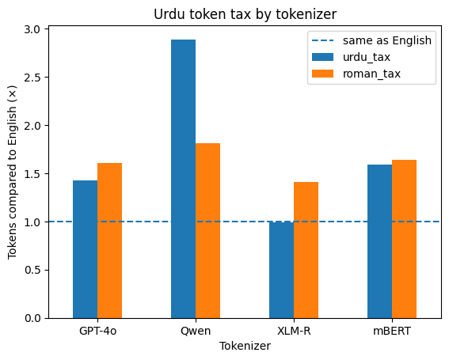

# Urdu Token Tax

**Question:** How many more tokens do AI models need for Urdu than for English, and does writing in Roman Urdu help?

Tokens are what language models read, process and charge for. If the same sentence costs more tokens in Urdu, Urdu users pay more, fit less text into the model's context, and wait longer for answers.



## Method
- 20 sentences, each written in English, Urdu script and Roman Urdu, mixing everyday and technical sentences and short and long ones.
- Tokens counted with 4 tokenizers: GPT-4o (`o200k_base`), XLM-RoBERTa, multilingual BERT and Qwen2.5. Special tokens were excluded so the counts are comparable.
- **Token tax** = average Urdu tokens ÷ average English tokens. A tax of 2.0 means twice the tokens for the same meaning.

## Results
Average tokens per sentence:

| Tokenizer | English | Urdu | Roman Urdu | Urdu tax | Roman Urdu tax |
|---|---|---|---|---|---|
| GPT-4o | 8.90 | 12.70 | 14.30 | 1.43 | 1.61 |
| Qwen2.5 | 8.95 | 25.85 | 16.20 | **2.89** | 1.81 |
| XLM-R | 9.30 | 9.25 | 13.10 | **0.99** | 1.41 |
| mBERT | 9.35 | 14.85 | 15.30 | 1.59 | 1.64 |

## Findings
1. **Qwen taxes Urdu the most.** It needs about 2.9× the tokens of English for the same sentence: almost 26 tokens where English needs 9.
2. **Roman Urdu is not a shortcut.** It costs more than Urdu script on GPT-4o, XLM-R and mBERT. It is cheaper only on Qwen, which handles Urdu script especially badly.
3. **The tax is not built into the language.** XLM-R, trained on a large amount of Urdu text, encodes Urdu as efficiently as English (0.99×). That suggests the gap comes from how a tokenizer was trained, and it can be closed.

**Why it matters:** for Urdu speakers, the same question can cost up to about 3× more on some models and use up their context window faster. Picking the right model, and building tokenizers with enough Urdu data, matters for anyone building AI for Pakistan.

## Limitations
- 20 sentence pairs, partly AI-drafted and checked by me. A larger, independent dataset could change the numbers.
- Roman Urdu has no standard spelling, so counts vary with how words are spelled.
- Token count measures cost and context use, not the quality of a model's answers.

## Run it
```bash
pip install -r requirements.txt
```
Open `token_tax.ipynb` and run all cells (it also runs as-is in Google Colab).
